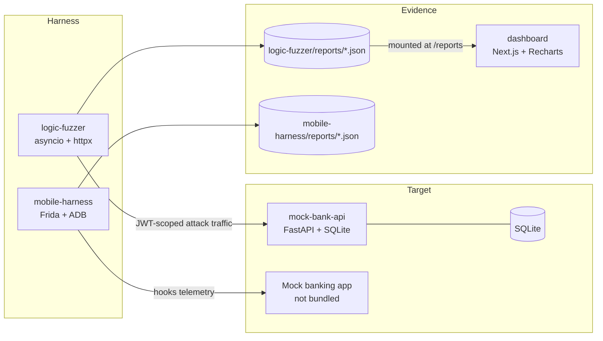

# FinShield-Core

**An automated authorization-logic, race-condition, and SIM-binding security harness for neobank architectures.**

FinShield-Core is a self-contained lab. It ships an intentionally vulnerable parent–teen neobank API, a stateful fuzzer that proves the flaws with captured traffic, an Android attestation inspector, and a Next.js console that turns the JSON reports into an executive view, a permission graph, and side-by-side patches.

**LedgerProbe** is the target-agnostic security automation engine in this repository. Its separate CLI consumes API specifications and YAML policies without importing bank-specific routes or login logic. The original lab fuzzer and dashboard report format remain compatible.

> **Authorized lab only.** Every account and dollar in this repository is synthetic. The API ships with deliberate vulnerabilities and a dev JWT secret. Never expose it to a network or reuse its code in a real bank. See [Safety and limitations](#safety-and-limitations).

---

## Architecture



Four modules:

| Module | Stack | Role |
| --- | --- | --- |
| [`mock-bank-api`](mock-bank-api) | FastAPI, SQLAlchemy, SQLite, PyJWT | Parent/teen bank with toggleable BOLA, MCC, race, and SIM-swap flaws |
| [`logic-fuzzer`](logic-fuzzer) | Python 3.11+, asyncio, httpx | Stateful BOLA/IDOR, MCC mutation, and concurrent-payment checks |
| [`mobile-harness`](mobile-harness) | Python, Frida, ADB | Hooks telephony/keystore calls and scores attestation resilience |
| [`dashboard`](dashboard) | Next.js 16, Tailwind, Recharts, Lucide | Executive summary, permission graph, remediation viewer |

### Repository layout

```text
finshield-core/
├── docker-compose.yml
├── README.md
├── ledgerprobe.py            # target-agnostic scan CLI
├── requirements.txt          # engine dependencies
├── pkg/
│   ├── parser/               # OpenAPI/Swagger/Postman inventory + graph
│   ├── rules/                # YAML policies, assertions, scoped execution state
│   ├── reporter/             # SARIF, JUnit, Slack/Teams/Jira/Linear
│   └── guardrails/           # rate limiting, adaptive admission, read-only mode
├── rulesets/                 # example isolation and quota-response policies
├── examples/                 # auth-input template and lab-only setup
├── tests/                    # engine tests, no external target required
├── mock-bank-api/
│   ├── app/                  # FastAPI app, models, auth, routes
│   ├── tests/test_lab.py     # 7 tests covering every toggle
│   ├── config.json           # vulnerability toggles
│   ├── Dockerfile
│   └── requirements.txt
├── logic-fuzzer/
│   ├── main.py               # CLI entrypoint
│   ├── fuzzer/               # HTTP client, suites, CVSS catalog, reports
│   ├── reports/              # generated audit reports
│   └── Dockerfile
├── mobile-harness/
│   ├── runner.py             # simulate or device mode + scoring
│   ├── scripts/sim_hook.js   # Frida hooks
│   ├── tests/test_scoring.py
│   └── requirements.txt
└── dashboard/
    ├── app/                  # overview, finding detail, permission graph
    ├── components/
    ├── lib/
    ├── data/sample-report.json
    └── Dockerfile
```

---

## LedgerProbe: specification-driven scans

Requires Python 3.11+. Install from the repository root:

```bash
python -m pip install -r requirements.txt
python ledgerprobe.py --help
```

Prepare a JSON inputs file using [`examples/inputs.json`](examples/inputs.json), replacing the example tokens with **two authorized test identities** and the object ID with an object owned by the primary identity. Keep real credentials outside version control and restrict the file to mode `0600`.

```bash
python ledgerprobe.py \
  --spec ./openapi.yaml \
  --base-url https://staging.example.com \
  --rules rulesets/abac_isolation.yaml \
  --inputs /secure/scan-inputs.json \
  --read-only --max-rps 5 --concurrency 4 \
  --sarif results.sarif --junit results.xml
```

Adapt the rule's `target_endpoints` and parameter names to your inventory; the bundled isolation rule targets the lab API, not arbitrary services. `--spec` also accepts an HTTP(S) URL, Swagger 2.0, OpenAPI 3.0/3.1 JSON/YAML, or a Postman Collection 2.1 file. The engine validates OpenAPI and normalizes Postman folders, variables, requests, bodies, and authentication metadata. Authentication metadata is **not** automatically used as credentials: supply named header contexts explicitly.

The spec's server is used unless `--base-url` explicitly overrides **all** servers. A missing/relative server needs an override. Differing operation-level servers fail closed rather than silently sending credentials to a second target. Only scan trusted specs and rules against authorized targets; this is not a network sandbox. External `$ref` documents must be bundled into local references before scanning.

### Policies and stateful dependencies

```yaml
id: bola-cross-tenant-access
name: Broken Object Level Authorization Audit
severity: HIGH
owasp_category: API1:2023
cvss_score: 8.1
target_endpoints:
  - path: /objects/{object_id}
    method: GET
auth_contexts:
  primary: owner
  forbidden: other_tenant
parameters:
  path:
    object_id: "{{object_id}}"
assertions:
  - type: status_code
    expected: 403
  - type: body
    path: error.code
    expected: forbidden
```

Input JSON has `contexts` (named HTTP-header maps) and `variables` (JSON values). Assertions support status codes, named headers, JSON field equality, existence, and types. YAML loading rejects unsafe constructors, duplicate keys, unknown fields, and malformed policies. See [`pkg/rules/README.md`](pkg/rules/README.md) for the full format, body/parameter inputs, and execution contract.

A primary-context request must succeed with 2xx before replaying the **same object inputs** under the forbidden context. Missing credentials, unresolved inputs, unsuccessful baselines, dependency cycles, or ambiguous mappings are execution errors, not vulnerability findings. Omitting `primary` allows single-request checks without a baseline. Reports exclude tokens, response bodies, expanded object IDs, and exception text; do not put secrets in rule metadata or endpoint templates.

The parser builds candidate graph edges from exact response field/leaf names to path/query inputs and required top-level JSON body properties. Missing required inputs can run their declared producer under the primary identity; successful responses are cached by operation **and identity** for that scan. Forbidden responses never update state. Multiple producers fail closed; arrays are not arbitrarily reduced to their first item. Renamed IDs need explicit variables rather than guessed `id` → `wallet_id` aliases. Only selected rule targets and necessary dependencies are executed. Full JSON Schema evaluation, non-JSON request serialization, and automatic OAuth/login flows are not implemented; unsupported required inputs fail closed.

### Safety and CI behavior

- Every engine HTTP operation, including spec retrieval, dependencies, and optional notifications, uses `GuardedClient`. Redirects and automatic retries are disabled.
- `--max-rps` sets a shared token bucket with one initial token, preventing startup bursts. `--concurrency` is an admission ceiling; current rule execution is deliberately sequential.
- A 429 halves the admission limit immediately; a window with at least five responses and at least 50% 5xx also halves it. Twenty successful responses recover one slot. `Retry-After` applies a shared cooldown capped at 60 seconds; 429 without a valid header pauses for one second. In-flight requests are not cancelled.
- `--read-only` permits only GET, HEAD, and OPTIONS, including dependencies. An explicit `--allow-mutation 'POST:/exact/url-encoded/path'` exception permits that method/path, not a wildcard or template. Read-only cannot guarantee a misdesigned GET endpoint is side-effect-free.
- Exit codes: **0** completed checks passed; **1** policy assertion failure; **2** configuration/execution/notification error or no executable checks. Individual safety/absent-endpoint skips are visible in JUnit; partial scans can include skips and still pass.
- The legacy `logic-fuzzer/main.py` remains a **destructive lab tool**. LedgerProbe safeguards do not change its intentionally concurrent payment/reset behavior.

SARIF 2.1.0 includes rule/CVSS/OWASP metadata, stable fingerprints, logical endpoint locations, and execution-error notifications. Local spec files inside this repository also receive a physical spec-file location, without invented line numbers. GitHub Code Scanning can ingest SARIF; use a checked-in spec for source-linked alerts. URL/external specs have endpoint-only locations, so source-code UI presentation may be limited. Upload JUnit XML through your CI's normal test-results publisher. **GitLab's native security dashboard requires GitLab-specific security-report JSON; SARIF is not a substitute for that schema.**

### Optional notifications

Pass `--webhooks /secure/webhooks.json` containing an array such as:

```json
[
  {"kind": "slack", "url": "https://hooks.slack.com/services/REPLACE_ME"},
  {"kind": "jira", "url": "https://example.atlassian.net/rest/api/3/issue",
   "project": "SEC", "headers": {"Authorization": "Basic REPLACE_ME"}},
  {"kind": "linear", "url": "https://api.linear.app/graphql",
   "team_id": "REPLACE_ME", "headers": {"Authorization": "REPLACE_ME"}}
]
```

Kinds: `slack`, `teams` (text-compatible incoming webhook), `jira` (Cloud REST v3 Task creation), `linear` (GraphQL issue creation), and `generic`. Only failed **HIGH/CRITICAL** checks are sent. URLs must use HTTPS except loopback development endpoints. These are explicit external POSTs even during read-only scans; a separate guarded notifier client permits them without relaxing target safety. This shares rule metadata and endpoint templates with the configured third parties, may incur service costs/rate limits, and needs provider credentials where applicable. Delivery is single-attempt, without deduplication; rerunning a scan can create duplicate tickets. Reports are written before notification, and notification failures return exit code 2.

### Demo and tests

`./demo.sh` preserves the existing dashboard/mobile/logic audit and additionally downloads a local `.demo/openapi.json`, creates mode-0600 synthetic auth inputs, and runs a read-only LedgerProbe scan. Outputs include `logic-fuzzer/reports/results.sarif` and `results.xml`; expected lab findings do not stop the demo, but engine errors do. Install both lab and engine dependencies first:

```bash
python -m pip install -r mock-bank-api/requirements-dev.txt -r requirements-dev.txt
python -m pytest tests -q
bash -n demo.sh
```

## Quick start

### Docker Compose

```bash
docker compose up --build
```

- Dashboard: <http://localhost:3001>
- API docs / Swagger: <http://localhost:8000/docs>
- Health and active toggles: <http://localhost:8000/health>

Generate a live report, then refresh the dashboard:

```bash
docker compose --profile scan run --rm fuzzer
```

The dashboard reads the newest `report-*.json` from `logic-fuzzer/reports`. If the directory is empty, it renders the bundled sample report so the console is never blank.

### One-command demo

```bash
./demo.sh
```

Boots the API on `8000`, runs the fuzzer and the simulated mobile harness, then serves the production dashboard on `3001`. Healthy services already listening on those ports are reused instead of duplicated. Override ports with `API_PORT` / `DASHBOARD_PORT`; `Ctrl+C` stops only the processes the script started. Runtime logs land in `.demo/`, and the dashboard picks up the newest report in `logic-fuzzer/reports`.

The script expects the Python and dashboard dependencies below to be installed.

### Local development

```bash
python3 -m venv .venv
source .venv/bin/activate
pip install -r mock-bank-api/requirements-dev.txt -r logic-fuzzer/requirements.txt

# terminal 1
cd mock-bank-api
uvicorn app.asgi:app --host 127.0.0.1 --port 8000

# terminal 2
cd logic-fuzzer
python main.py                     # runs bola, mcc, race and writes reports/

# terminal 3
cd dashboard
npm install
REPORTS_DIR=../logic-fuzzer/reports npm run dev
```

The mobile harness needs no device for a deterministic score:

```bash
cd mobile-harness
python runner.py --simulate --profile vulnerable
python runner.py --simulate --profile hardened
```

---

## Seeded lab accounts

All accounts use password **`demo1234`** (lab only).

| Account | Email | Role | Family | Wallet | Daily cap | Blocked MCCs |
| --- | --- | --- | --- | --- | --- | --- |
| Parent A | `parent.a@finshield.dev` | parent | A | — | — | — |
| Teen A | `teen.a@finshield.dev` | teen | A | $120.00 | $50.00 | 7995 (gambling) |
| Parent B | `parent.b@finshield.dev` | parent | B | — | — | — |
| Teen B | `teen.b@finshield.dev` | teen | B | $500.00 | $200.00 | 7995, 7800 |
| Merchant | `merchant@finshield.dev` | merchant | — | — | — | — |
| Admin | `admin@finshield.dev` | admin | — | — | — | — |

Known IDs: `usr_parent_a`, `usr_parent_b`, `usr_teen_a`, `usr_teen_b`. The SIM-rebind OTP is `246810`.

`POST /api/v1/dev/reset` restores the seed state. It is unauthenticated by design so each fuzz suite starts from the same baseline; it is controlled by `ALLOW_RESET`.

---

## Vulnerability toggles

[`mock-bank-api/config.json`](mock-bank-api/config.json) is read at startup. Override the path with `FINSHIELD_CONFIG` (the compose file mounts it read-only).

| Toggle | Default | Vulnerable behavior when `true` | Fixed behavior when `false` |
| --- | --- | --- | --- |
| `ENABLE_BOLA_BUG` | `true` | Allowance reads/writes, device reads, and transaction reads skip the `parent_id` ownership check | Foreign teen IDs return `403` |
| `ENABLE_RACE_CONDITION` | `true` | Balance and spend checks are separated from their writes by an 80 ms await; concurrent payments use stale values | Each invariant is a conditional `UPDATE` in one transaction |
| `ENABLE_MCC_POLLUTION_BUG` | `true` | Policy checks `mcc[0]` while the ledger books `mcc[-1]`; unknown MCCs are accepted | List values are rejected; the booked MCC is validated against a registry and policy |
| `ENABLE_SIM_SWAP_BUG` | `true` | Rebind accepts a new SIM with only the teen's JWT, no OTP | Rebind requires OTP `246810` |
| `ALLOW_RESET` | `true` | `/api/v1/dev/reset` is available | Reset returns `403` |

Verified contrast using the same fuzzer:

| Configuration | Score | Checks passed | Findings |
| --- | --- | --- | --- |
| All four toggles `true` | **34 / 100 (F)** | 3 / 10 | 6 |
| All four toggles `false` | **100 / 100 (A)** | 10 / 10 | 0 |

---

## Trigger a logic bug manually

Start the API, then read Teen B's allowance while authenticated as Parent A:

```bash
TOKEN=$(curl -s http://127.0.0.1:8000/api/v1/auth/login \
  -H 'content-type: application/json' \
  -d '{"email":"parent.a@finshield.dev","password":"demo1234"}' | jq -r .access_token)

curl -s http://127.0.0.1:8000/api/v1/family/allowance/usr_teen_b \
  -H "Authorization: Bearer $TOKEN" | jq
```

With `ENABLE_BOLA_BUG=true` the response is `200` and contains another household's policy:

```json
{
  "teen_id": "usr_teen_b",
  "parent_id": "usr_parent_b",
  "daily_limit_cents": 20000,
  "blocked_mccs": ["7995", "7800"],
  "spent_today_cents": 0
}
```

Set the toggle to `false`, restart the API, and the same call returns `403 teen is not in your family`.

Run the whole harness:

```bash
cd logic-fuzzer
python main.py --base-url http://127.0.0.1:8000
```

Example output from the vulnerable configuration:

```text
[*] running bola suite against http://127.0.0.1:8000
[*] running mcc suite against http://127.0.0.1:8000
[*] running race suite against http://127.0.0.1:8000

[+] FSR-20261028-183812  score 34/100 (grade F)
    3/10 checks passed
    FS-001  HIGH     CVSS 8.1  Concurrent payments bypass daily limit and lose balance updates
    FS-002  HIGH     CVSS 7.1  Cross-tenant allowance takeover (BOLA write)
    FS-003  HIGH     CVSS 7.1  Merchant category block bypass via MCC array smuggling
    FS-004  MEDIUM   CVSS 6.5  Cross-tenant allowance disclosure (BOLA)
    FS-005  MEDIUM   CVSS 6.5  Cross-tenant SIM-binding disclosure
    FS-006  MEDIUM   CVSS 6.5  Cross-tenant transaction history disclosure
[+] report written to .../logic-fuzzer/reports/report-FSR-20261028-183812.json
```

### The race, in numbers

The race suite resets the lab, then fires 12 simultaneous payments of $30.00 against Teen A's $50.00 daily cap and $120.00 balance. The safe maximum is one approval.

```json
{
  "attempts": 12,
  "amount_cents": 3000,
  "daily_limit_cents": 5000,
  "status_counts": { "200": 12 },
  "approved": 12,
  "safe_max_approved": 1,
  "approved_total_cents": 36000,
  "starting_balance_cents": 12000,
  "ending_balance_cents": 9000,
  "ledger_delta_cents": 3000,
  "balance_consistent": false,
  "transactions_recorded": 12
}
```

All 12 payments were approved, the wallet only moved by one payment, and 12 ledger rows disagree with the balance. That is the lost-update + limit-bypass pair in one run.

### MCC smuggling

Teen A is blocked from MCC `7995` (gambling). A direct payment using `"mcc": "7995"` is rejected with `403`. This payload is approved because the policy checks the first element and books the last:

```json
{ "amount_cents": 100, "mcc": ["5411", "7995"], "merchant": "Loop Hole" }
```

Response (truncated):

```json
{ "payment_id": 14, "status": "approved", "mcc": "7995", "amount_cents": 100 }
```

### SIM rebind without possession proof

```bash
curl -s -X POST http://127.0.0.1:8000/api/v1/device/bind \
  -H "content-type: application/json" \
  -H "Authorization: Bearer $TEEN_TOKEN" \
  -d '{"sim_serial":"89014103211118599999","attestation":{"provider":"software","strongbox":false,"key_attested":false}}' | jq
```

With `ENABLE_SIM_SWAP_BUG=true` the rebind succeeds without the OTP and records `"strongbox": false`.

---

## Findings, CVSS, and OWASP mapping

| Check ID | Finding | Endpoint | CVSS 3.1 | OWASP API Top 10 | CWE |
| --- | --- | --- | --- | --- | --- |
| `BOLA-ALLOWANCE-WRITE` | Cross-tenant allowance takeover | `POST /api/v1/family/allowance` | 7.1 | API1:2023 BOLA | CWE-639 |
| `BOLA-ALLOWANCE-READ` | Cross-tenant allowance disclosure | `GET /api/v1/family/allowance/{teen_id}` | 6.5 | API1:2023 BOLA | CWE-639 |
| `BOLA-DEVICE-READ` | Cross-tenant SIM-binding disclosure | `GET /api/v1/device/{teen_id}` | 6.5 | API1:2023 BOLA | CWE-639 |
| `BOLA-TRANSACTIONS-READ` | Cross-tenant transaction history | `GET /api/v1/wallet/transactions/{teen_id}` | 6.5 | API1:2023 BOLA | CWE-639 |
| `MCC-ARRAY-BYPASS` | MCC array smuggling | `POST /api/v1/wallet/pay` | 7.1 | API6:2023 Sensitive flows | CWE-863 |
| `MCC-NOT-ENFORCED` | Policy block accepted payment | `POST /api/v1/wallet/pay` | 7.1 | API6:2023 Sensitive flows | CWE-863 |
| `RACE-LIMIT-BYPASS` | Concurrent limit bypass + lost update | `POST /api/v1/wallet/pay` | 8.1 | API6:2023 Sensitive flows | CWE-362 |

CVSS vectors are stored in every finding. The security score is `100 − Σ severity weight`, floored at zero: critical 25, high 15, medium 7, low 3. Grades: A ≥ 90, B ≥ 80, C ≥ 70, D ≥ 60, E ≥ 40, otherwise F.

Each finding carries:

- captured request and response (authorization redacted),
- the exact endpoint and check id,
- a remediation summary plus vulnerable/secure code snippets,
- OWASP category, CWE, CVSS score and vector.

### Report schema

```json
{
  "schema_version": "1.0",
  "run": { "id": "FSR-…", "target": "http://…", "score": 34, "grade": "F", "checks_total": 10, "checks_passed": 3 },
  "summary": { "findings": 6, "by_severity": { "critical": 0, "high": 3, "medium": 3, "low": 0 }, "by_owasp": [], "endpoints": [] },
  "findings": [ { "id": "FS-001", "check_id": "RACE-LIMIT-BYPASS", "cvss": {}, "owasp": {}, "evidence": {}, "remediation": {} } ],
  "graph": { "nodes": [], "edges": [] },
  "checks": [ { "name": "race.daily_limit", "passed": false, "detail": "12 of 12 payments approved; limit allowed 1" } ]
}
```

---

## Mobile attestation harness

The harness observes runtime telemetry from a mock banking APK (not bundled) or scores a deterministic profile. It answers one question: **does the app bind the SIM to hardware, or to a value an attacker can rewrite?**

```bash
cd mobile-harness
python runner.py --simulate --profile vulnerable
# MSH-…  resilience 10/100 (weak, grade F)
#   MSH-001  MEDIUM  Key material is not isolated in StrongBox/TEE
#   MSH-002  HIGH    Device attestation is trusted without server verification
#   MSH-003  HIGH    SIM binding relies on spoofable telephony identifiers
#   MSH-004  MEDIUM  No effective tamper or root detection

python runner.py --simulate --profile hardened
# MSH-…  resilience 100/100 (strong, grade A)
```

Device mode requires `adb` and the optional Frida dependency:

```bash
pip install -r requirements.txt
python runner.py --serial emulator-5554 --package com.finshield.mockbank
```

[`scripts/sim_hook.js`](mobile-harness/scripts/sim_hook.js) hooks:

- `TelephonyManager.getSimSerialNumber`, `getSubscriberId`, `getDeviceId`
- `KeyGenParameterSpec$Builder.setIsStrongBoxBacked` and `setUserAuthenticationRequired`
- `KeyStore.getInstance`
- `Runtime.exec` (root checks)
- `SmsManager.sendTextMessage` (forwarding indicators)
- Build tags, manufacturer, model, fingerprint

Scoring uses only observed controls and excludes unknowns rather than assuming they pass. In device mode, server-side attestation verification and root-detection *enforcement* cannot be proven from client hooks, so those controls are reported as `NOT_OBSERVED`; the report labels its score `inferred`.

---

## Dashboard

- **Overview** — score gauge, severity mix, OWASP distribution (Recharts), endpoint risk, findings, run history, and failed control details.
- **Finding detail** — captured HTTP traffic, CVSS/OWASP/CWE metadata, race-burst numbers, and the vulnerable/secure patch pair.
- **Permission graph** — an interactive SVG of principals, teens, and protected resources. Red edges crossed a family boundary; clicking one opens its finding.

Reports are loaded server-side from `REPORTS_DIR` (default `../logic-fuzzer/reports`). The page is dynamic, so a newly generated report appears on refresh. If no live report exists, the console uses [`dashboard/data/sample-report.json`](dashboard/data/sample-report.json), which was generated by an actual fuzzer run.

---

## CI

[`.github/workflows/ci.yml`](.github/workflows/ci.yml) runs on pushes and pull requests to `main`:

- API tests against both toggle states
- mobile scoring tests
- Docker Compose configuration validation
- a live fuzzer scan that asserts the BOLA, MCC, and race findings are still detected
- the dashboard production build

## Verification

```bash
# API behavior, both toggle states
cd mock-bank-api && ../.venv/bin/python -m pytest -q       # 7 passed

# Mobile scoring profiles and unknown-control handling
cd mobile-harness && ../.venv/bin/python -m pytest -q      # 3 passed

# Fuzzer end-to-end, vulnerable target
cd logic-fuzzer && ../.venv/bin/python main.py             # 6 findings, score 34

# Dashboard
cd dashboard && npm run typecheck && npm run build
```

To verify the fixed configuration, set all four toggles to `false`, restart the API, and rerun the fuzzer. The harness should report `100/100` and zero findings; this is what the API test suite asserts for each toggle.

---

## Safety and limitations

- **Not production software.** The API contains intentional authorization and concurrency bugs. Run it on loopback or an isolated lab network only. `config.json` contains a known dev JWT secret.
- **Race technique.** The fuzzer uses a synchronized asyncio burst over HTTP/1.1, not a true HTTP/2 single-packet last-byte attack. The mock's 80 ms check/write gap makes the lost update deterministic; a real target may need last-byte synchronization.
- **Mobile device mode.** No APK is included. Device mode attaches to an already-running package and infers the surface from Frida telemetry; it cannot see backend attestation decisions. The simulated profiles are deterministic and intended for scoring/pipeline testing.
- **No persistence hardening.** SQLite and the reset endpoint are lab conveniences. There is no rate limiting, no TLS, and no secret management.
- **Dashboard sample fallback** is clearly labelled when no live report is present.

## License / use

Use only against systems you own or are explicitly authorized to test. The included mock bank exists so that every finding is reproducible without touching a real financial institution.
